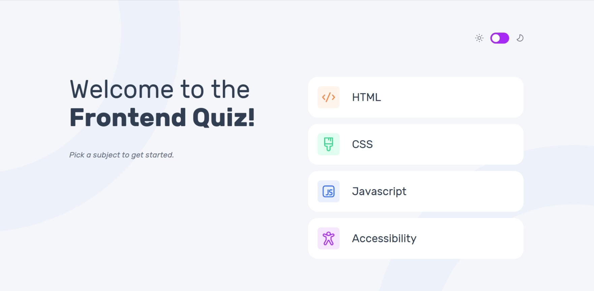

# Frontend Mentor - Password generator app solution

This is my solution to the [Frontend Quiz app challenge on Frontend Mentor](https://www.frontendmentor.io/challenges/frontend-quiz-app-BE7xkzXQnU).

## Table of contents

- [Overview](#overview)
  - [The challenge](#the-challenge)
  - [Screenshot](#screenshot)
  - [Links](#links)
- [My process](#my-process)
  - [Built with](#built-with)
  - [What I learned](#what-i-learned)
- [Author](#author)

## Overview

### The challenge

The challenge is to build a quiz covering four subjects: HTML, CSS, JavaScript, and Accessibility.

Users should be able to:

- Select a quiz subject
- Select a single answer from each question from a choice of four
- See an error message when trying to submit an answer without making a selection
- See if they have made a correct or incorrect choice when they submit an answer
- Move on to the next question after seeing the question result
- See a completed state with the score after the final question
- Play again to choose another subject
- See hover and focus states for all interactive elements on the page

### Screenshot

### Links

- Solution URL: [Solution URL](https://github.com/Vinicius-PR/frontend-quiz-app)
- Live Site URL: [live site URL](https://frontend-quiz-app-orcin-ten.vercel.app/)

## My process

### Built with

- Vite
- React
- Styled-components
- TypeScript

### What I learned

With this project, I learned more about using **data-*** attributes in HTML elements to control different visual states. When working with styled-components, this approach was especially useful for applying conditional styles.

Also, I learned how to organize themes, colors, and breakpoints, making the project easier to maintain and update in the future.

## Author

- Frontend Mentor - [@Vinicius-PR](https://www.frontendmentor.io/profile/Vinicius-PR)
- Linkedin - [@Vinicius](https://www.linkedin.com/in/vinicius-paula-resende/)
